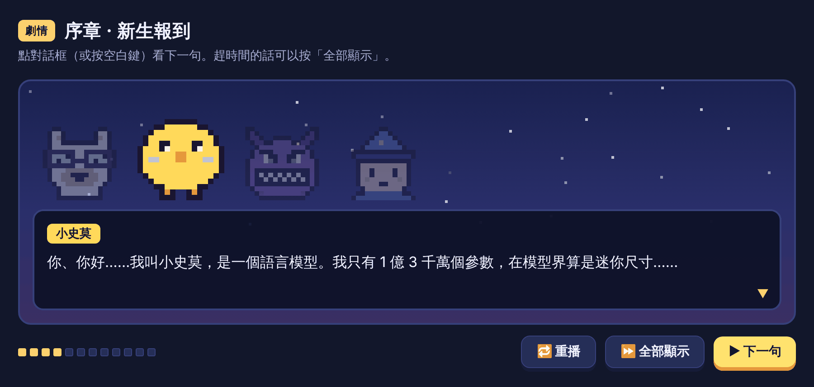
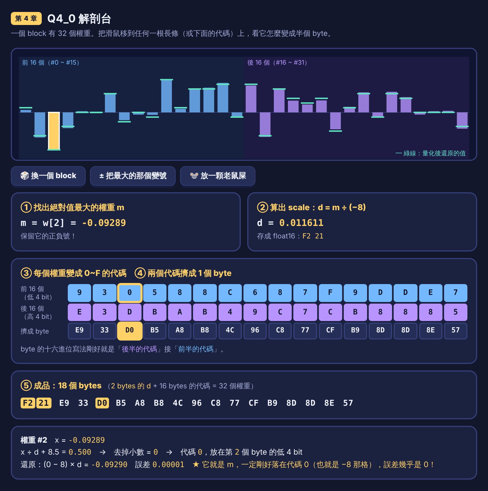
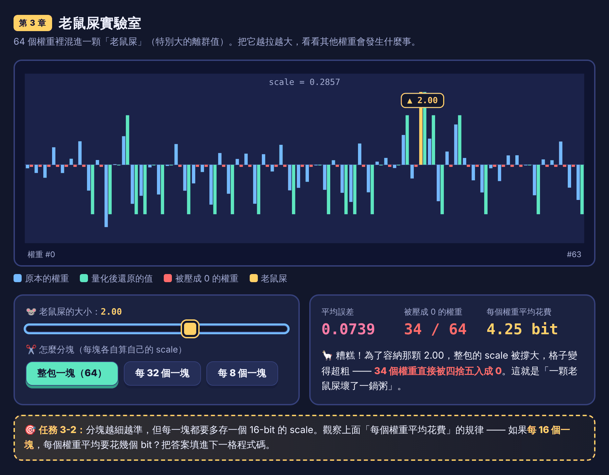
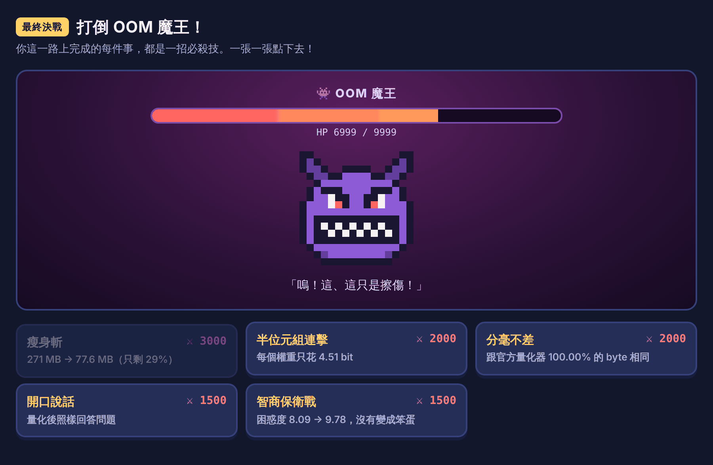

# 🦙 量化教室 Quantize Classroom

**把 AI 塞進口袋的 4-bit 大冒險** —— 一本可以玩的 Jupyter Notebook，帶學生從「什麼是量化」一路做到
**親手把一個語言模型量化成 Q4_0 的 GGUF 檔**。

> 一隻叫咕咕夫的駱馬教授、一個想回家的迷你語言模型小史莫、一個專吃記憶體的 OOM 魔王 —— 以及你，量化學院的新生。



## 這門課會做什麼

學生會在自己的電腦上（只用 CPU）完成整個量化流程：

```
Hugging Face 模型  ──▶  轉成 GGUF（F16）  ──▶  量化成 Q4_0  ──▶  實際跑起來、檢定品質
   269 MB                  271 MB                78 ~ 92 MB
```

而且是做**兩次**：先用自己一行一行寫出來的 Q4_0 量化器做一次，再用業界標準的 `llama-quantize` 做一次，然後逐 byte 比對。

| 章節 | 主題 | 互動內容 |
|:--|:--|:--|
| 序章 | 新生報到、環境準備 | 劇情動畫 |
| 第 1 章 | 模型為什麼這麼胖？ | 🎮 記憶體峽谷的磅秤 |
| 第 2 章 | 量化 = 選最近的格子 | 🎮 甜度量化機 |
| 第 3 章 | 離群值與分塊量化 | 🎮 老鼠屎實驗室 |
| 第 4 章 | Q4_0 格式逐位元解剖 | 🎮 Q4_0 解剖台、人肉量化機 |
| 第 5 章 | 下載模型、轉成 GGUF、看懂檔案結構 | 🎮 GGUF 藏寶箱地圖 |
| 第 6 章 | 用自己寫的量化器量化整個模型 | 🎮 過橋檢查 |
| 第 7 章 | 官方工具 `llama-quantize` | 手工版 vs 官方版比對 |
| 第 8 章 | 讓量化後的模型說話、量品質 | 🎮 魔王戰、畢業考、畢業證書 |

全程 23 個任務、2,120 點經驗值、9 枚徽章，大約 2～3 小時。使用的模型是
[SmolLM2-135M-Instruct](https://huggingface.co/HuggingFaceTB/SmolLM2-135M-Instruct)（1.35 億個參數，約 270 MB）。

| | |
|:--:|:--:|
|  |  |
| Q4_0 解剖台：看 32 個權重怎麼變成 18 個 byte | 老鼠屎實驗室：一個離群值如何毀掉整批權重 |

<p align="center"><br>
最終決戰：學生一路上的成果（檔案變多小、跟官方工具多一致、品質掉多少）會變成打魔王的必殺技</p>

（彩蛋：這份 README 裡的圖片都被量化成 160 色了。）

## 🎒 學生：怎麼開始

需要 **Python 3.10 以上**、網路連線、約 2 GB 硬碟空間。不需要顯示卡。

### 方法一：在自己的電腦上（建議）

```bash
git clone https://github.com/Dot7dot/quatize-classroom.git
cd quatize-classroom
pip install jupyterlab
jupyter lab
```

打開 `quantize_classroom.ipynb`，從第一格開始，一格一格往下執行（`Shift + Enter`）。
第一格會自動安裝需要的套件（PyTorch 比較大，第一次要等幾分鐘）。

沒有 git 的話，在 GitHub 頁面按 **Code → Download ZIP**，解壓縮後一樣在該資料夾裡執行 `jupyter lab`。

### 方法二：VS Code

用 VS Code 打開這個資料夾，安裝 Python 與 Jupyter 擴充套件，點開 `quantize_classroom.ipynb`，選一個 Python 3.10+ 的 kernel 即可。

### 方法三：Google Colab

[](https://colab.research.google.com/github/Dot7dot/quatize-classroom/blob/main/quantize_classroom.ipynb)

第一格會自動把整個專案抓下來。Colab 的檔案在工作階段結束後會消失，記得把做好的 `.gguf` 下載回來。

### 玩法

- 🎯 **任務**：把程式碼裡的 `...` 換成答案再執行，過關就有經驗值。
- 💡 **卡住了**：執行 `quest.hint("任務編號")`，每執行一次多一個提示；提示用完才會出現解答（看解答的話經驗值減半）。
- 💾 **存檔**：進度自動存在 `quest_save.json`。隔天再開，從第一格重新執行就能接著玩。
- 🔁 **重來**：`quest.reset("我確定")`。

### 做完之後你會有

```
workspace/gguf/
├── smol-f16.gguf              量化前的模型
├── smol-Q4_0-handmade.gguf    用你自己寫的量化器做出來的 Q4_0 模型
└── smol-Q4_0.gguf             用官方 llama-quantize 做出來的 Q4_0 模型
```

都是標準的 GGUF 檔，可以直接拿給 llama.cpp 用：`llama-cli -m workspace/gguf/smol-Q4_0.gguf`

## 🧑‍🏫 給老師

### 專案結構

```
quantize_classroom.ipynb   教材本體（故事、說明、任務、實戰流程都在這裡）
requirements.txt           需要的 Python 套件
quest/                     遊戲引擎（學生不需要看，但歡迎翻閱）
├── story.py               ← 所有劇情對話、畢業考題目。想改台詞、加梗改這裡
├── hints.py               ← 每個任務的提示、解答、答案
├── checks.py              任務檢查器（會針對常見錯誤給具體的回饋）
├── game.py                經驗值、等級、徽章、存檔
├── q4.py                  Q4_0 的參考實作（跟 llama.cpp 逐 byte 一致）
├── toolbox.py             下載模型、取得 llama.cpp、執行指令、備用轉檔器
├── ggufkit.py             GGUF 讀寫與比較的小幫手
├── ui.py                  把互動元件嵌進 Notebook
└── web/                   互動小遊戲（純 HTML / CSS / JavaScript，沒有外部相依）
tests/run_notebook.py      自動測試：填入解答，把整本 Notebook 真的跑一遍
```

### 上課前建議

1. **先在教室的電腦上試跑一次**：
   ```bash
   pip install nbclient nbformat ipykernel
   python tests/run_notebook.py
   ```
   它會填入所有解答、執行整本 Notebook（含下載模型與官方工具），最後報告 23 個任務是否全數過關。
   改過教材之後也建議跑一次，確認沒有改壞。
2. **網路**：每位學生需要下載約 270 MB 的模型、約 200 MB 的 PyTorch（若還沒安裝）、約 25 MB 的 llama.cpp。
   教室網路不穩的話，可以先在一台電腦上跑完，把整個 `workspace/` 資料夾複製給學生 —— Notebook 偵測到檔案已存在就不會重新下載。
3. **工具版本**：llama.cpp 固定使用 `b12244` 這個版本（設定在 `quest/toolbox.py` 的 `LLAMA_TAG`），確保每位學生拿到的工具相同。

### 不會卡關的設計

實戰章節的每一步都有備案，任何一個外部工具拿不到都能繼續：

| 步驟 | 首選 | 備案 |
|:--|:--|:--|
| 轉成 GGUF | 官方 `convert_hf_to_gguf.py` | 內建的備用轉檔器（輸出的張量與官方逐 byte 相同） |
| 官方量化 | 自動下載預先編譯的 `llama-quantize` | 與官方 `gguf` 套件的 Q4_0 參考實作比對 |
| 讓模型說話 | `llama-completion` | 把 GGUF 的權重解量化後裝回 PyTorch 執行 |

### 測試狀態

- 已實際跑完整本並通過：Linux x64、Python 3.13、JupyterLab 4（含官方轉檔腳本、`llama-quantize`、`llama-completion`）。
  在這個環境下，學生手寫的量化器與官方 `llama-quantize` 在所有 Q4_0 張量上 **100% 逐 byte 相同**。
- Windows、macOS、Colab 的下載與執行流程是依照 llama.cpp 官方發行檔的命名與結構撰寫的，但**尚未在這些平台上實機測試**；
  若官方工具在某個平台上跑不起來，會自動走上表的備案。建議開課前依「上課前建議」第 1 點試跑。

## ❓ 常見問題

**第一格跑很久** —— 正在安裝 PyTorch。只有第一次需要。

**顯示「這台電腦暫時拿不到 llama.cpp」** —— 不影響過關。想用官方工具的話：Windows 執行 `winget install llama.cpp`、
macOS 執行 `brew install llama.cpp`，然後重新啟動 Jupyter。

**互動小遊戲是一片空白** —— 重新執行那一格。如果是打開別人存檔的 Notebook，需要先「信任」它（或直接重新執行）。

**想讓小史莫說中文** —— 它只有 1.35 億個參數，主要學的是英文。延伸挑戰裡有換成會說中文的模型的方法。

## 🙏 致謝與授權

- [llama.cpp](https://github.com/ggml-org/llama.cpp) 與 `gguf` 套件（MIT License）—— 執行時才下載，本專案沒有收錄其程式碼。
- [SmolLM2-135M-Instruct](https://huggingface.co/HuggingFaceTB/SmolLM2-135M-Instruct)，Hugging Face TB（Apache License 2.0）—— 執行時才下載。

> 「量化不是魔法，是四捨五入，加上一點點小聰明。」—— 咕咕夫教授
